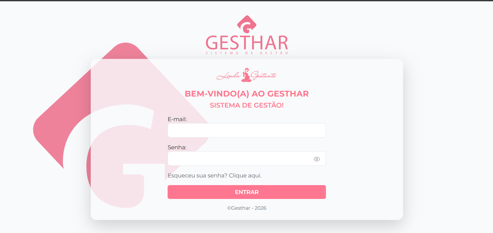
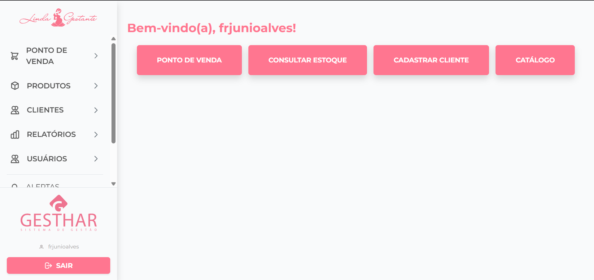
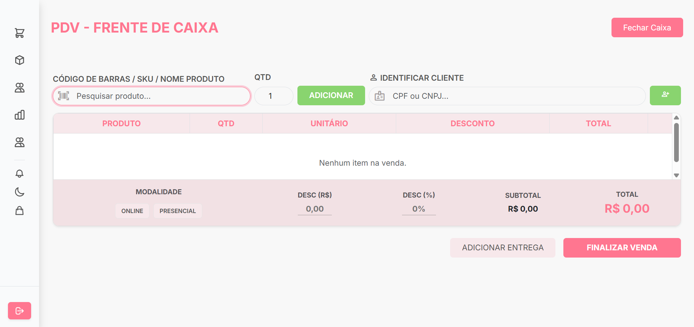

# Gesthar 🤰


Sistema de Ponto de Venda (PDV) e controle de estoque para a loja **Linda Gestante**, uma loja de roupas para gestantes e lactantes de Parnaíba (PI).

Projeto de extensão desenvolvido no **IFPI – Campus Parnaíba**, no curso Tecnologia em Análise e Desenvolvimento de Sistemas, como atividade das disciplinas **Extensão Curricular I (2025)** e **Extensão Curricular II (2026)**.

## 📋 Sumário

- [Sobre o Projeto](#sobre-o-projeto)
- [Telas do Sistema](#telas-do-sistema)
- [Funcionalidades](#funcionalidades)
- [Tecnologias](#tecnologias)
- [Estrutura do Projeto](#estrutura-do-projeto)
- [Como Executar](#como-executar)
- [Testes](#testes)
- [Equipe](#equipe)
- [Padrão de Commits](#padrão-de-commits)

## Sobre o Projeto

Antes do Gesthar, a Linda Gestante fazia suas vendas por WhatsApp e Instagram, controlava o caixa em anotações manuais e gerenciava o estoque de memória. Isso gerava perda de informação, dificuldade de reposição e baixa previsibilidade de demanda.

O objetivo do projeto é automatizar:

- o **controle de estoque**, com baixa automática após cada venda;
- o **registro de vendas** pelo PDV, com busca por nome, SKU ou código de barras;
- o **cadastro de clientes**, incluindo data prevista do parto e preferências de tamanho;
- a **emissão de relatórios** de estoque, vendas e financeiro para apoiar decisões de compra e promoções.

O projeto é entregue **gratuitamente** pela equipe de alunos à empresa parceira, que cobre apenas a infraestrutura. A stack é open-source (Django + PostgreSQL + Bootstrap), sem mensalidade de SaaS.

### Cronograma resumido

| Etapa | Período | Entregas |
| ----- | ------- | -------- |
| Extensão Curricular I | Set/2025 – Jan/2026 | Levantamento de requisitos, diagramas UML e de ER, protótipos no Figma, ambiente configurado, módulos de produtos/estoque, PDV, login e clientes (parcial) |
| Extensão Curricular II | 2026 | Finalização do módulo de Clientes, controle de acesso por perfil, integração de pagamentos (Mercado Pago Point, PIX e cartão), catálogo online e relatórios financeiros |

> A documentação completa do projeto (requisitos, diagramas e protótipos) está em [`docs/Projeto Extensão I - GESTHAR - Linda Gestante 2025.md`](docs/Projeto%20Extensão%20I%20-%20GESTHAR%20-%20Linda%20Gestante%202025.md).

## Telas do Sistema

| Login | Início | PDV |
| ----- | ------ | --- |
|  |  |  |

## Funcionalidades

- **Autenticação** de usuários, com recuperação de senha por e-mail.
- **Ponto de Venda (PDV)**: busca de produtos, carrinho, descontos em R$ ou %, modalidade online/presencial, identificação do cliente por CPF/CNPJ e finalização da venda.
- **Pagamento via Mercado Pago Point**, com webhook assinado, atualização em tempo real e simulação para testes.
- **Produtos e estoque**: cadastro com tamanho, cor, SKU, estoque mínimo e movimentações de entrada e saída.
- **Alertas** de estoque mínimo e de notificações (incluindo mensagens de acompanhamento de gestação via WhatsApp).
- **Clientes**: cadastro e histórico de compras.
- **Relatórios** de estoque, vendas e financeiro.
- **Catálogo web** para consulta de produtos.
- **Usuários** com registro de logs de acesso e ações, com IP e data.
- **Modo escuro** (dark mode) na interface.

## Tecnologias

- [Python 3.12](https://www.python.org/) e [Django 4.2](https://www.djangoproject.com/)
- [PostgreSQL 15](https://www.postgresql.org/)
- [Bootstrap 5](https://getbootstrap.com/) e [Figma](https://www.figma.com/) para protótipos
- [WhiteNoise](https://whitenoise.readthedocs.io/) para arquivos estáticos
- [WeasyPrint](https://weasyprint.org/) para geração de PDF
- Docker e Docker Compose
- GitHub Actions para testes e deploy da imagem no Docker Hub

## Estrutura do Projeto

| Pasta | Responsabilidade |
| ----- | ---------------- |
| `base/` | Página inicial e templates base |
| `accounts/` | Login, logout e recuperação de senha |
| `user/` | Cadastro de usuários e logs de acesso |
| `product/` | Produtos, variações e movimentações |
| `stock/` | Controle de estoque e alertas |
| `customer/` | Cadastro de clientes |
| `sales/` | PDV, vendas e integração com Mercado Pago |
| `catalog/` | Catálogo web |
| `notifications/` | Notificações e mensagens |
| `core/` | Configurações do Django (settings e urls) |
| `docs/` | Planos de ação, relatórios e documentação do projeto |
| `init_db/` | Scripts de inicialização do PostgreSQL |

## Como Executar

### Pré-requisitos

- Python 3.12
- Docker e Docker Compose (para o PostgreSQL)

### 1. Configurar variáveis de ambiente

```bash
cp .env.example .env
```

Preencha `SECRET_KEY`, as credenciais do banco (`DB_*`) e, se for usar, as credenciais de e-mail e do Mercado Pago.

### 2. Subir o banco de dados

```bash
docker compose up -d db
```

O PostgreSQL fica disponível na porta `5433` do host.

### 3. Instalar dependências e preparar o banco

```bash
python -m venv .venv
source .venv/bin/activate        # Windows: .venv\Scripts\activate
pip install -r requirements.txt
python manage.py migrate
python manage.py createsuperuser
```

### 4. Rodar o servidor

```bash
python manage.py runserver
```

Acesse `http://localhost:8000`.

## Testes

```bash
python manage.py test
```

O projeto possui cerca de 270 testes automatizados distribuídos pelos módulos. A pipeline do GitHub Actions executa a suíte a cada push e pull request em `main` e `develop`. Detalhes em [`.github/workflows/README.md`](.github/workflows/README.md).

## Equipe

Projeto desenvolvido por discentes do curso de TADS do IFPI – Campus Parnaíba:

- Cauã Wesly Silva Rocha
- Elinne Pacheco Pessoa
- Fernanda Oliveira de Farias
- Francisco Junio Alves Barros
- Thiago Carvalho da Silva

**Orientador(a):** Prof. Me. José Renato de Moura Silva Barroso

**Instituição:** Instituto Federal de Educação, Ciência e Tecnologia do Piauí (IFPI) – Campus Parnaíba
**Parceira:** Linda Gestante

## Padrão de Commits

**`Estrutura da Mensagem de Commit`**

>`!`: indica os atributos obrigatórios

>`?`: indica os atributos opcionais

```
!tipo(?escopo): !descrição

?corpo
```
| Atributo | Detalhe | Observações |
| ----------- | ----------- | ----------- |
| tipo | Uma única palavra em minúsculas que define a categoria da alteração | [Tipos de commits](https://medium.com/linkapi-solutions/conventional-commits-pattern-3778d1a1e657)
| escopo | Identifica parte do código alterada | 1. fix(login): corrige validação de senha (a correção foi na área de login).<br>2. feat(api): adiciona endpoint de usuários (a nova funcionalidade foi na API).
| descrição | Um resumo curto e direto do que a alteração faz | 1. Comece com letra minúscula. <br>2. Use o modo imperativo (como se estivesse dando uma ordem): "corrige", "adiciona", "remove" em vez de "corrigido", "adicionando". <br>3. Não termine com um ponto final.
| corpo | Texto mais longo e detalhado | Use o corpo para fornecer contexto que não cabe na descrição

`Exemplo`
```
docs(readme): documenta o padrão de commits do projeto

Esta alteração adiciona uma seção detalhada ao README para formalizar o padrão de
mensagens de commit (Conventional Commits) a ser utilizado no projeto.
```
